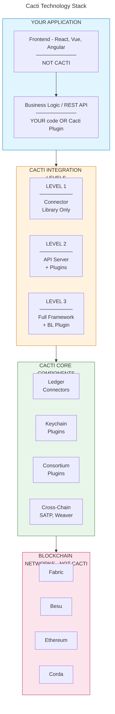
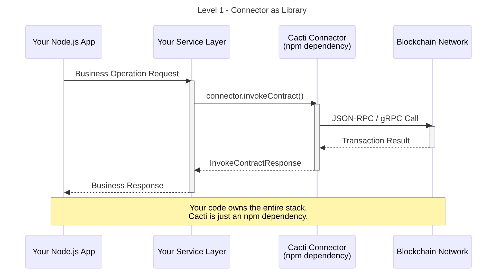
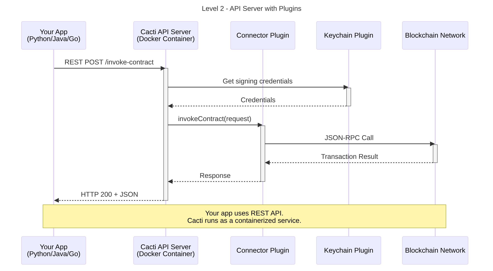
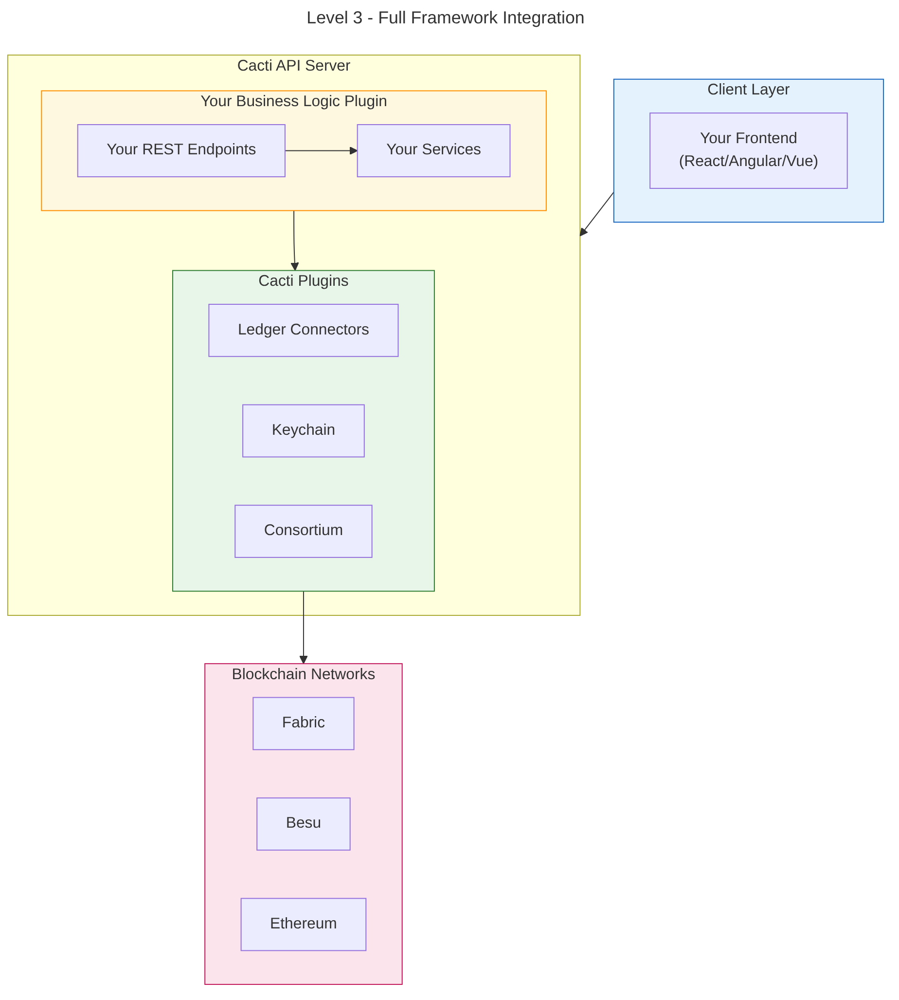

# Getting Started with Hyperledger Cacti

Welcome to Hyperledger Cacti! This guide will help you understand the framework and choose the right level of integration for your project.

## Table of Contents

- [Understanding Cacti's Architecture](#understanding-cactis-architecture)
- [What is Cacti vs What Isn't](#what-is-cacti-vs-what-isnt)
- [Choosing Your Level of Immersion](#choosing-your-level-of-immersion)
- [Level 1: Connector as a Library](#level-1-connector-as-a-library-lowest-immersion)
- [Level 2: API Server with Plugins](#level-2-api-server-with-plugins-medium-immersion)
- [Level 3: Full Framework Integration](#level-3-full-framework-integration-highest-immersion)
- [Deciding Which Level is Right for You](#deciding-which-level-is-right-for-you)

---

## Understanding Cacti's Architecture

Cacti is a **modular, pluggable framework** for blockchain interoperability. Pick and choose the components you need for your use-case.

### Technology Stack Diagram



---

## What is Cacti vs What Isn't

Understanding what Cacti provides (and what it doesn't) is crucial for successful integration.

### ✅ What IS Cacti

| Component | Description | Package |
|-----------|-------------|---------|
| **Ledger Connectors** | Plugins that abstract interaction with specific blockchains | `@hyperledger/cactus-plugin-ledger-connector-*` |
| **Keychain Plugins** | Secure credential storage (Vault, AWS SM, Azure KV, Memory) | `@hyperledger/cactus-plugin-keychain-*` |
| **API Server** | Express-based server that hosts plugins and exposes REST/gRPC APIs | `@hyperledger/cactus-cmd-api-server` |
| **Core API** | Common interfaces, types, and abstractions | `@hyperledger/cactus-core-api` |
| **Common Utilities** | Logging, HTTP, and shared utilities | `@hyperledger/cactus-common` |
| **Plugin Registry** | Mechanism to register and discover plugins | `@hyperledger/cactus-core` |
| **Cross-Chain Protocols** | SATP (Hermes), Weaver, COPM for interoperability | `@hyperledger/cactus-plugin-satp-hermes`, etc. |
| **Consortium Management** | Multi-organization coordination | `@hyperledger/cactus-plugin-consortium-*` |
| **Test Tooling** | Docker-based test ledgers and utilities | `@hyperledger/cactus-test-tooling` |

### ❌ What is NOT Cacti (in the examples)

| Component | Description | What You'll See in Examples |
|-----------|-------------|----------------------------|
| **Frontend Application** | The web UI | React/Angular apps in `examples/*-frontend` |
| **Your Business Logic** | Domain-specific rules and workflows | Custom code in `examples/*-business-logic-plugin` |
| **Your REST API endpoints** | Application-specific endpoints | Routes defined in your business logic |
| **Database** | Persistent storage for your app | Your choice (PostgreSQL, MongoDB, etc.) |
| **Authentication Provider** | Your identity management | Keycloak, Auth0, custom JWT, etc. |

---

## Choosing Your Level of Immersion

| Level | Use Case | Complexity | What You Get |
|-------|----------|------------|--------------|
| **Level 1** | You have an existing Node.js app and just need blockchain connectivity | Low | Connector as npm dependency |
| **Level 2** | You have a non-Node.js app or want containerized blockchain access | Medium | API server with REST/gRPC endpoints |
| **Level 3** | You want a complete blockchain-integrated application framework | High | Full stack with business logic plugins |

---

## Level 1: Connector as a Library (Lowest Immersion)

**Best for:** Existing Node.js/TypeScript projects that need to interact with a blockchain.

### What You Get

- Direct programmatic access to blockchain operations
- Type-safe API with TypeScript definitions
- No additional infrastructure required

### What You Provide

- Your existing application architecture
- Your own API endpoints (if needed)
- Your own authentication and authorization

### Architecture



### Tutorial: Using the Ethereum Connector in Your Existing Project

#### Step 1: Install Dependencies

```bash
# In your existing Node.js project
npm install @hyperledger/cactus-plugin-ledger-connector-ethereum
npm install @hyperledger/cactus-core
npm install @hyperledger/cactus-common
```

#### Step 2: Create and Configure the Connector

```typescript
// src/blockchain/ethereum-client.ts
import {
  PluginLedgerConnectorEthereum,
  Web3SigningCredentialType,
  DefaultApi as EthereumApi,
} from "@hyperledger/cactus-plugin-ledger-connector-ethereum";
import { PluginRegistry } from "@hyperledger/cactus-core";
import { v4 as uuidv4 } from "uuid";

export class EthereumClient {
  private connector: PluginLedgerConnectorEthereum;

  constructor(rpcApiHttpHost: string) {
    // Create the connector - this is the only Cacti component you need!
    this.connector = new PluginLedgerConnectorEthereum({
      instanceId: uuidv4(),
      rpcApiHttpHost: rpcApiHttpHost,
      pluginRegistry: new PluginRegistry(),
      logLevel: "INFO",
    });
  }

  /**
   * Deploy a smart contract to the Ethereum network
   */
  async deployContract(
    bytecode: string,
    abi: unknown[],
    privateKey: string,
    ethAccount: string,
  ): Promise<string> {
    const result = await this.connector.deployContract({
      bytecode,
      contractAbi: abi,
      web3SigningCredential: {
        type: Web3SigningCredentialType.PrivateKeyHex,
        ethAccount,
        secret: privateKey,
      },
      gas: 1000000,
    });
    return result.transactionReceipt?.contractAddress ?? "";
  }

  /**
   * Invoke a contract method (state-changing transaction)
   */
  async invokeContract(
    contractAddress: string,
    contractAbi: unknown[],
    methodName: string,
    params: unknown[],
    privateKey: string,
    ethAccount: string,
  ): Promise<unknown> {
    return this.connector.invokeContract({
      contractAddress,
      contractAbi,
      invocationType: "SEND",
      methodName,
      params,
      web3SigningCredential: {
        type: Web3SigningCredentialType.PrivateKeyHex,
        ethAccount,
        secret: privateKey,
      },
      gas: 1000000,
    });
  }

  /**
   * Query a contract method (read-only call)
   */
  async queryContract(
    contractAddress: string,
    contractAbi: unknown[],
    methodName: string,
    params: unknown[],
  ): Promise<unknown> {
    return this.connector.invokeContract({
      contractAddress,
      contractAbi,
      invocationType: "CALL",
      methodName,
      params,
      web3SigningCredential: {
        type: Web3SigningCredentialType.None,
      },
    });
  }
}
```

#### Step 3: Use in Your Application

```typescript
// src/services/asset-service.ts
import { EthereumClient } from "../blockchain/ethereum-client";
import AssetContract from "../contracts/Asset.json";

export class AssetService {
  private ethereumClient: EthereumClient;
  private contractAddress: string;

  constructor() {
    this.ethereumClient = new EthereumClient(process.env.ETHEREUM_RPC_URL!);
    this.contractAddress = process.env.ASSET_CONTRACT_ADDRESS!;
  }

  async createAsset(
    assetId: string,
    owner: string,
    privateKey: string,
    ethAccount: string,
  ): Promise<void> {
    await this.ethereumClient.invokeContract(
      this.contractAddress,
      AssetContract.abi,
      "createAsset",
      [assetId, owner],
      privateKey,
      ethAccount,
    );
  }

  async getAssetOwner(assetId: string): Promise<string> {
    const result = await this.ethereumClient.queryContract(
      this.contractAddress,
      AssetContract.abi,
      "getOwner",
      [assetId],
    );
    return result as string;
  }
}
```

#### Step 4: Integrate with Your Existing API

```typescript
// src/routes/assets.ts (e.g., Express.js)
import express from "express";
import { AssetService } from "../services/asset-service";

const router = express.Router();
const assetService = new AssetService();

// Your existing API patterns - Cacti is just a library you use
router.post("/assets", async (req, res) => {
  try {
    const { assetId, owner, privateKey, ethAccount } = req.body;
    await assetService.createAsset(assetId, owner, privateKey, ethAccount);
    res.status(201).json({ success: true, assetId });
  } catch (error: unknown) {
    const message = error instanceof Error ? error.message : "Unknown error";
    res.status(500).json({ error: message });
  }
});

router.get("/assets/:assetId/owner", async (req, res) => {
  try {
    const owner = await assetService.getAssetOwner(req.params.assetId);
    res.json({ assetId: req.params.assetId, owner });
  } catch (error: unknown) {
    const message = error instanceof Error ? error.message : "Unknown error";
    res.status(500).json({ error: message });
  }
});

export default router;
```

### Available Connectors for Level 1

| Connector | Package | Ledger |
|-----------|---------|--------|
| Ethereum | `@hyperledger/cactus-plugin-ledger-connector-ethereum` | Ethereum, Geth, etc. |
| Besu | `@hyperledger/cactus-plugin-ledger-connector-besu` | Hyperledger Besu |
| Fabric | `@hyperledger/cactus-plugin-ledger-connector-fabric` | Hyperledger Fabric |
| Corda | `@hyperledger/cactus-plugin-ledger-connector-corda` | R3 Corda |
| Polkadot | `@hyperledger/cactus-plugin-ledger-connector-polkadot` | Polkadot/Substrate |
| Stellar | `@hyperledger/cacti-plugin-ledger-connector-stellar` | Stellar |

---

## Level 2: API Server with Plugins (Medium Immersion)

**Best for:** 

- Non-Node.js applications (Python, Java, Go, etc.) that need blockchain access via REST/gRPC
- Microservices architectures where you want containerized blockchain connectivity
- Teams that want built-in authentication, authorization, and observability

### What You Get

- REST and gRPC APIs for all plugin operations
- Built-in authentication (JWT, OAuth2, etc.)
- Containerized deployment ready
- OpenAPI/Swagger documentation
- Prometheus metrics
- Multiple ledger support in one server

### What You Provide

- Your application (any language/framework)
- Configuration for the API server
- Deployment infrastructure (Kubernetes, Docker, etc.)

### Architecture



### Tutorial: Running Cacti API Server with Ethereum Connector

#### Step 1: Run the API Server Container

```bash
docker run \
  --rm \
  --publish 4000:4000 \
  --env AUTHORIZATION_PROTOCOL='NONE' \
  --env AUTHORIZATION_CONFIG_JSON='{}' \
  --env GRPC_TLS_ENABLED=false \
  --env API_TLS_ENABLED=false \
  --env API_HOST=0.0.0.0 \
  --env API_PORT=4000 \
  --env LOG_LEVEL=INFO \
  ghcr.io/hyperledger/cactus-cmd-api-server:latest \
    node index.js \
      --plugins='[{"packageName":"@hyperledger/cactus-plugin-ledger-connector-ethereum","type":"org.hyperledger.cactus.plugin_import_type.LOCAL","action":"org.hyperledger.cactus.plugin_import_action.INSTALL","options":{"instanceId":"eth-connector","rpcApiHttpHost":"http://host.docker.internal:8545"}}]'
```

#### Step 2: Use the REST API from Any Language

**Python Example:**

```python
# python-client/ethereum_client.py
import requests
from typing import Any

class CactiEthereumClient:
    """Client for interacting with Cacti API Server's Ethereum connector."""
    
    def __init__(self, base_url: str, jwt_token: str | None = None):
        self.base_url = base_url
        self.headers = {"Content-Type": "application/json"}
        if jwt_token:
            self.headers["Authorization"] = f"Bearer {jwt_token}"

    def deploy_contract(
        self,
        bytecode: str,
        abi: list,
        private_key: str,
        eth_account: str,
    ) -> dict[str, Any]:
        """Deploy a smart contract via Cacti API."""
        response = requests.post(
            f"{self.base_url}/api/v1/plugins/@hyperledger/cactus-plugin-ledger-connector-ethereum/deploy-contract-solidity-bytecode",
            headers=self.headers,
            json={
                "bytecode": bytecode,
                "contractAbi": abi,
                "web3SigningCredential": {
                    "type": "PRIVATE_KEY_HEX",
                    "ethAccount": eth_account,
                    "secret": private_key,
                },
                "gas": 1000000,
            },
            timeout=30,
        )
        response.raise_for_status()
        return response.json()

    def invoke_contract(
        self,
        contract_address: str,
        abi: list,
        method: str,
        params: list,
        private_key: str,
        eth_account: str,
    ) -> dict[str, Any]:
        """Invoke a smart contract method (state-changing)."""
        response = requests.post(
            f"{self.base_url}/api/v1/plugins/@hyperledger/cactus-plugin-ledger-connector-ethereum/invoke-contract",
            headers=self.headers,
            json={
                "contractAddress": contract_address,
                "contractAbi": abi,
                "invocationType": "SEND",
                "methodName": method,
                "params": params,
                "web3SigningCredential": {
                    "type": "PRIVATE_KEY_HEX",
                    "ethAccount": eth_account,
                    "secret": private_key,
                },
                "gas": 1000000,
            },
            timeout=30,
        )
        response.raise_for_status()
        return response.json()

    def query_contract(
        self,
        contract_address: str,
        abi: list,
        method: str,
        params: list,
    ) -> dict[str, Any]:
        """Query a smart contract (read-only)."""
        response = requests.post(
            f"{self.base_url}/api/v1/plugins/@hyperledger/cactus-plugin-ledger-connector-ethereum/invoke-contract",
            headers=self.headers,
            json={
                "contractAddress": contract_address,
                "contractAbi": abi,
                "invocationType": "CALL",
                "methodName": method,
                "params": params,
                "web3SigningCredential": {"type": "NONE"},
            },
            timeout=30,
        )
        response.raise_for_status()
        return response.json()


# Usage example
if __name__ == "__main__":
    client = CactiEthereumClient("http://localhost:4000")
    
    result = client.query_contract(
        contract_address="0x...",
        abi=[{"name": "balanceOf", "type": "function", "inputs": [...], "outputs": [...]}],
        method="balanceOf",
        params=["0xYourAddress"],
    )
    print(f"Balance: {result}")
```

**Go Example:**

```go
// go-client/main.go
package main

import (
    "bytes"
    "encoding/json"
    "fmt"
    "net/http"
    "time"
)

// CactiClient provides access to Cacti API Server
type CactiClient struct {
    BaseURL    string
    HTTPClient *http.Client
}

// NewCactiClient creates a new Cacti client
func NewCactiClient(baseURL string) *CactiClient {
    return &CactiClient{
        BaseURL:    baseURL,
        HTTPClient: &http.Client{Timeout: 30 * time.Second},
    }
}

// InvokeContractRequest represents the request body
type InvokeContractRequest struct {
    ContractAddress       string                 `json:"contractAddress"`
    ContractAbi           []interface{}          `json:"contractAbi"`
    InvocationType        string                 `json:"invocationType"`
    MethodName            string                 `json:"methodName"`
    Params                []interface{}          `json:"params"`
    Web3SigningCredential map[string]interface{} `json:"web3SigningCredential"`
    Gas                   int                    `json:"gas,omitempty"`
}

// QueryContract performs a read-only contract call
func (c *CactiClient) QueryContract(
    contractAddress string,
    abi []interface{},
    methodName string,
    params []interface{},
) (map[string]interface{}, error) {
    request := InvokeContractRequest{
        ContractAddress:       contractAddress,
        ContractAbi:           abi,
        InvocationType:        "CALL",
        MethodName:            methodName,
        Params:                params,
        Web3SigningCredential: map[string]interface{}{"type": "NONE"},
    }

    body, err := json.Marshal(request)
    if err != nil {
        return nil, err
    }

    resp, err := c.HTTPClient.Post(
        c.BaseURL+"/api/v1/plugins/@hyperledger/cactus-plugin-ledger-connector-ethereum/invoke-contract",
        "application/json",
        bytes.NewBuffer(body),
    )
    if err != nil {
        return nil, err
    }
    defer resp.Body.Close()

    var result map[string]interface{}
    if err := json.NewDecoder(resp.Body).Decode(&result); err != nil {
        return nil, err
    }
    return result, nil
}

func main() {
    client := NewCactiClient("http://localhost:4000")
    result, err := client.QueryContract(
        "0x...",
        []interface{}{}, // ABI
        "getBalance",
        []interface{}{},
    )
    if err != nil {
        fmt.Printf("Error: %v\n", err)
        return
    }
    fmt.Printf("Result: %v\n", result)
}
```

### API Documentation

Once the server is running, access the OpenAPI documentation at:

- Swagger UI: `http://localhost:4000/api/v1/api-docs`
- OpenAPI JSON: `http://localhost:4000/api/v1/openapi.json`

---

## Level 3: Full Framework Integration (Highest Immersion)

**Best for:**

- New projects starting from scratch that want a complete blockchain-integrated stack
- Applications that need sophisticated cross-chain workflows
- Teams that want to leverage Cacti's full feature set including business logic plugins

### What You Get

- Everything from Level 2, plus:
- Business Logic Plugin framework for custom application logic
- Consortium management for multi-organization scenarios
- Cross-chain protocols (SATP, Weaver) for interoperability
- Frontend integration patterns
- Complete example applications as templates

### What You Provide

- Your business logic as a Cacti plugin
- Your frontend application
- Domain-specific smart contracts

### Architecture



### Tutorial: Building a Complete Application

This small application keeps the existing asset creation and lookup workflow
in one file. A custom business logic plugin runs inside the Cacti API server
and uses the Ethereum connector to deploy and call a Solidity contract.
A frontend, local workspace package, and separate endpoint modules are not
required for this exercise.

#### Step 1: Prepare a Separate Application

Use Node.js 20 and npm. Run the commands outside the Cacti repository so
npm does not modify its Yarn installation. This example uses the published
`@hyperledger` packages at version `2.0.0`; do not mix them with the current
repository's `@hyperledger-cacti` workspaces.

```bash
app_dir=$(mktemp -d "$HOME/cacti-developer-review.XXXXXX")
cd "$app_dir"
printf 'Application directory: %s\n' "$app_dir"
npm init -y
npm install @hyperledger/cactus-cmd-api-server@2.0.0 \
  @hyperledger/cactus-core@2.0.0 \
  @hyperledger/cactus-plugin-ledger-connector-ethereum@2.0.0 \
  solc@0.8.21
```

Keep the printed directory path for the second terminal. Dependency audit
findings are separate from whether the application runs successfully.

Start a local Ethereum development ledger, or reuse the matching ledger
from the [SATP operator walkthrough](../satp-hermes/operations.md#2-start-the-development-ledger).
Do not start another ledger if port `8545` is occupied.

```bash
docker run -d --name cacti-developer-ledger \
  -p 127.0.0.1:8545:8545 trufflesuite/ganache:v7.9.2 \
  --server.host 0.0.0.0 \
  --wallet.mnemonic 'test test test test test test test test test test test junk' \
  --chain.chainId 1337 --logging.quiet

curl --fail-with-body http://localhost:8545 \
  -H 'Content-Type: application/json' \
  --data '{"jsonrpc":"2.0","id":1,"method":"eth_accounts","params":[]}'
```

Wait for the RPC request to succeed. The first funded account must be
`0xf39fd6e51aad88f6f4ce6ab8827279cfffb92266`. Ganache is archived and is
used here only as a reproducible local fixture. Its public development
mnemonic and private key must never be used with real assets.
If the named container already exists, use `docker start cacti-developer-ledger`.

#### Step 2: Define the Asset Contract

In the application directory, create `Asset.sol`:

```solidity
// SPDX-License-Identifier: Apache-2.0
pragma solidity ^0.8.21;

contract Asset {
    struct Record {
        address owner;
        uint256 value;
        bool exists;
    }
    mapping(string => Record) private assets;

    function createAsset(string calldata assetId, address owner, uint256 value) external {
        require(bytes(assetId).length > 0, "Asset ID is required");
        require(owner != address(0), "Owner is required");
        require(value > 0, "Asset value must be positive");
        require(!assets[assetId].exists, "Asset already exists");
        assets[assetId] = Record(owner, value, true);
    }

    function getAsset(string calldata assetId) external view returns (address owner, uint256 value) {
        require(assets[assetId].exists, "Asset not found");
        Record storage asset = assets[assetId];
        return (asset.owner, asset.value);
    }
}
```

#### Step 3: Register the Business Logic Plugin

Create `app.cjs` beside `Asset.sol`. The application compiles the contract
in memory and deploys it, so no prebuilt artifact or deployed address is
required. The plugin supplies its OpenAPI definition and both endpoint
implementations rather than importing unspecified example modules.

```javascript
const { readFileSync } = require("node:fs");
const { randomUUID } = require("node:crypto");
const solc = require("solc");
const { ApiServer, ConfigService, AuthorizationProtocol } =
  require("@hyperledger/cactus-cmd-api-server");
const { PluginRegistry } = require("@hyperledger/cactus-core");
const {
  PluginLedgerConnectorEthereum,
  EthContractInvocationType,
  Web3SigningCredentialType,
} = require("@hyperledger/cactus-plugin-ledger-connector-ethereum");

const basePath = "/api/v1/my-app/assets";
const owner = "0xf39fd6e51aad88f6f4ce6ab8827279cfffb92266";
const credential = {
  type: Web3SigningCredentialType.PrivateKeyHex,
  ethAccount: owner,
  secret: "0xac0974bec39a17e36ba4a6b4d238ff944bacb478cbed5efcae784d7bf4f2ff80",
};
const gasConfig = { gas: "3000000", gasPrice: "20000000000" };

class MyAppPlugin {
  constructor(connector, contract) {
    this.instanceId = randomUUID();
    this.connector = connector;
    this.contract = contract;
    this.endpoints = [
      this.endpoint("post", basePath, async (req, res) => {
        const { assetId, owner: assetOwner, value } = req.body || {};
        if (typeof assetId !== "string" || !assetId.trim() ||
            !/^0x[0-9a-fA-F]{40}$/.test(assetOwner || "") ||
            /^0x0{40}$/i.test(assetOwner) ||
            !Number.isSafeInteger(value) || value <= 0) {
          res.status(400).json({ error: "Invalid asset ID, owner, or value" });
          return;
        }
        const result = await this.connector.invokeContract({
          contract: this.contract,
          invocationType: EthContractInvocationType.Send,
          methodName: "createAsset",
          params: [assetId, assetOwner, value],
          web3SigningCredential: credential,
          gasConfig,
        });
        // Version 2.0.0 returns Send receipts under out; accept both shapes.
        const receipt = result.transactionReceipt ?? result.out?.transactionReceipt;
        if (!result.success || !receipt?.status || !receipt.transactionHash) {
          throw new Error("Asset transaction failed");
        }
        res.status(201).json({ assetId, transactionHash: receipt.transactionHash });
      }),
      this.endpoint("get", `${basePath}/:assetId`, async (req, res) => {
        const result = await this.connector.invokeContract({
          contract: this.contract,
          invocationType: EthContractInvocationType.Call,
          methodName: "getAsset",
          params: [req.params.assetId],
          web3SigningCredential: { type: Web3SigningCredentialType.None },
        });
        res.json({ assetId: req.params.assetId, owner: result.callOutput.owner,
          value: String(result.callOutput.value) });
      }),
    ];
  }
  endpoint(verb, path, handler) {
    const endpoint = {
      getVerbLowerCase: () => verb,
      getPath: () => path,
      getAuthorizationOptionsProvider: () => ({
        get: async () => ({ isProtected: false, requiredRoles: [] }),
      }),
      getExpressRequestHandler: () => async (req, res) => {
        try { await handler(req, res); }
        catch (error) { res.status(500).json({ error: error.message }); }
      },
      registerExpress: async (app) => {
        app[verb](path, endpoint.getExpressRequestHandler());
        return endpoint;
      },
    };
    return endpoint;
  }
  getInstanceId() { return this.instanceId; }
  getPackageName() { return "my-app-business-logic-plugin"; }
  async onPluginInit() {}
  async shutdown() {}
  getOpenApiSpec() {
    return {
      openapi: "3.0.3",
      info: { title: "Asset Application", version: "1.0.0" },
      paths: {
        [basePath]: { post: {
          operationId: "createAsset",
          requestBody: { required: true, content: {
            "application/json": { schema: { type: "object" } },
          } },
          responses: { "201": { description: "Asset created" },
            "400": { description: "Invalid asset input" },
            "500": { description: "Ledger request failed" } },
        } },
        [`${basePath}/{assetId}`]: { get: {
          operationId: "getAsset",
          parameters: [{ name: "assetId", in: "path", required: true,
            schema: { type: "string" } }],
          responses: { "200": { description: "Asset from the ledger" },
            "500": { description: "Ledger request failed" } },
        } },
      },
    };
  }
  async getOrCreateWebServices() { return this.endpoints; }
  async registerWebServices(app) {
    for (const endpoint of this.endpoints) await endpoint.registerExpress(app);
    return this.endpoints;
  }
}

async function main() {
  const compiled = JSON.parse(solc.compile(JSON.stringify({
    language: "Solidity",
    sources: { "Asset.sol": { content: readFileSync("Asset.sol", "utf8") } },
    settings: { evmVersion: "paris",
      outputSelection: { "*": { "*": ["abi", "evm.bytecode.object"] } } },
  })));
  const errors = (compiled.errors || []).filter((e) => e.severity === "error");
  if (errors.length) throw new Error(errors.map((e) => e.formattedMessage).join("\n"));
  const output = compiled.contracts["Asset.sol"].Asset;
  const artifact = { abi: output.abi, bytecode: `0x${output.evm.bytecode.object}` };
  const registry = new PluginRegistry();
  const connector = new PluginLedgerConnectorEthereum({
    instanceId: randomUUID(), pluginRegistry: registry,
    rpcApiHttpHost: process.env.ETHEREUM_RPC_URL || "http://127.0.0.1:8545",
    logLevel: "WARN",
  });
  registry.add(connector);
  const deployed = await connector.deployContract({
    contract: { contractJSON: artifact }, web3SigningCredential: credential,
    gasConfig,
  });
  const contractAddress = deployed.transactionReceipt.contractAddress;
  if (!deployed.transactionReceipt.status || !contractAddress) {
    throw new Error("Contract deployment failed");
  }
  registry.add(new MyAppPlugin(connector, { contractAddress, contractJSON: artifact }));
  const config = await new ConfigService().newExampleConfig();
  Object.assign(config, {
    authorizationProtocol: AuthorizationProtocol.NONE, configFile: "",
    apiHost: "127.0.0.1", apiPort: 4400, cockpitEnabled: false,
    apiTlsEnabled: false, apiMtlsEnabled: false, grpcMtlsEnabled: false,
    grpcPort: 0, crpcPort: 0, logLevel: "WARN", enableShutdownHook: false,
  });
  const server = new ApiServer({ config, pluginRegistry: registry });
  await server.start();
  for (const signal of ["SIGINT", "SIGTERM"]) {
    process.once(signal, () => server.shutdown().catch(console.error));
  }
  console.log(`Contract: ${contractAddress}`);
  console.log(`READY http://127.0.0.1:4400${basePath}`);
}
main().catch((error) => { console.error(error); process.exit(1); });
```

#### Step 4: Run and Verify

In the application directory:

```bash
node app.cjs
```

Wait for `READY`. The API listens only on the loopback interface. Authentication
and TLS are disabled for this local exercise; do not expose it as a public
service. Each startup deploys a new contract.

In a second terminal, create an asset and read it back:

```bash
curl --fail-with-body -i http://localhost:4400/api/v1/my-app/assets \
  -H 'Content-Type: application/json' \
  --data '{"assetId":"review-1","owner":"0xf39fd6e51aad88f6f4ce6ab8827279cfffb92266","value":100}'

curl --fail-with-body -i http://localhost:4400/api/v1/my-app/assets/review-1
```

Expect HTTP `201` and a transaction hash for creation, then HTTP `200` with
the same asset ID and owner and value `"100"`. The service converts the
contract's integer result to a decimal string before JSON serialization.
Use a new asset ID for each creation on the same contract.

Check the transaction independently, replacing the placeholder with the hash
returned by creation:

```bash
curl --fail-with-body http://localhost:8545 \
  -H 'Content-Type: application/json' \
  --data '{"jsonrpc":"2.0","id":1,"method":"eth_getTransactionReceipt","params":["TRANSACTION_HASH"]}'
```

Expect receipt status `"0x1"`. Also confirm that invalid input is rejected:

```bash
curl -i http://localhost:4400/api/v1/my-app/assets \
  -H 'Content-Type: application/json' \
  --data '{"assetId":"invalid","owner":"0xf39fd6e51aad88f6f4ce6ab8827279cfffb92266","value":0}'
```

Expect HTTP `400`. Press Ctrl+C in the application terminal when finished.
Stop the ledger with `docker stop cacti-developer-ledger` if you created it
for this exercise, or keep the shared ledger running for the operator review.

### What's Cacti vs What's Yours (Level 3 Summary)

| Category | Your Code | Cacti |
|----------|-----------|-------|
| **Frontend** | Optional application UI | - |
| **Business Logic** | `MyAppPlugin` asset handlers in `app.cjs` | Plugin interface (`IPluginWebService`) |
| **REST Endpoints** | Endpoint definitions in `app.cjs` | Endpoint registration helpers |
| **Smart Contracts** | `Asset.sol` | - |
| **Blockchain Access** | - | Ledger Connectors |
| **Credential Storage** | - | Keychain Plugins |
| **API Hosting** | - | ApiServer |
| **Plugin Discovery** | - | PluginRegistry |

---

## Deciding Which Level is Right for You

| Question | Level 1 | Level 2 | Level 3 |
|----------|---------|---------|---------|
| Do you have an existing Node.js project? | ✅ Best fit | ✅ Works | ✅ Works |
| Is your project in Python/Java/Go/etc.? | ❌ | ✅ Best fit | ✅ Works |
| Do you need containerized deployment? | ❌ | ✅ Best fit | ✅ |
| Do you need built-in auth/authz? | ❌ | ✅ | ✅ |
| Are you building a new project from scratch? | ✅ Works | ✅ Works | ✅ Best fit |
| Do you need cross-chain transactions (SATP)? | ❌ | ✅ | ✅ Best fit |
| Do you need multi-organization consortium? | ❌ | ✅ | ✅ Best fit |
| Want minimal Cacti footprint? | ✅ Best fit | ❌ | ❌ |

---

## Next Steps

- **Level 1**: Check out the [connector documentation](../cactus/packages.md) for your target ledger
- **Level 2**: See the [API Server configuration guide](../cactus/packages/cactus-cmd-api-server.md)
- **Level 3**: Study the applications in the [Cacti Demos repository](https://github.com/hyperledger-cacti/cacti-demos) as complete references

## Getting Help

- [Discord](https://discord.com/channels/905194001349627914/908379338716631050) - Community support
- [GitHub Issues](https://github.com/hyperledger-cacti/cacti/issues) - Bug reports and feature requests
- [Documentation](https://hyperledger-cacti.github.io/cacti/) - Full documentation
---\n\n<small>Generated with GitHub Copilot as directed by rafaelapb</small>
