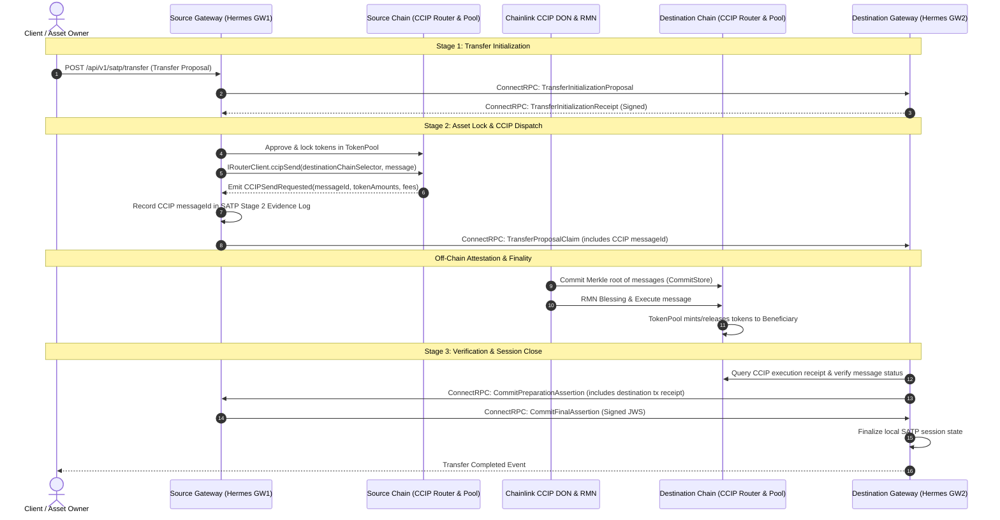

# SATP Hermes Cross-Chain Transfer over Chainlink CCIP Lane

This guide demonstrates a two-gateway asset transfer using the Secure Asset Transfer Protocol (SATP) Hermes architecture routed over a Chainlink Cross-Chain Interoperability Protocol (CCIP) lane.

Part of Hyperledger Cacti SATP Hermes cross-chain bridge integration (Epic #4780).

---

## Architecture Overview

In a standard SATP transfer between heterogeneous ledgers, two gateways coordinate a 3-stage transfer lifecycle:

1. **Stage 1: Transfer Initialization** - Gateways establish cryptographic session, agree on asset terms, and exchange public keys.
2. **Stage 2: Lock and Assertion** - The source gateway locks the asset in source escrow/token pool and dispatches cross-chain verification claims.
3. **Stage 3: Extinguish and Regeneration** - Once cross-chain finality and claim evidence are verified, the destination gateway mints/unlocks the asset to the beneficiary and closes the session.

When routing over a Chainlink CCIP lane, the cross-chain message passing and token transfer execute across the CCIP router and token pools. The SATP claim chain captures the CCIP message lifecycle (`messageId`, commit store attestation, and execution receipts), ensuring verifiable auditability across both gateway operators.



---

## Evidence and Claim Verification Parity

To satisfy bank-grade auditability, evidence logged during the transfer must consume cryptographic proofs from the CCIP message lifecycle:

| SATP Stage | Evidence Captured | Source / Contract Event |
|---|---|---|
| Stage 1 | Session agreement, initial nonces, participant identities | Gateway JWS signatures |
| Stage 2 | Source lock transaction receipt, `gasUsed`, block confirmation | `TokenPool.Locked` / `EVMLeaf.getTransactionReceipt` |
| Stage 2 | CCIP Message Identifier (`bytes32 messageId`), lane selector | `Router.CCIPSendRequested` |
| Stage 3 | CCIP commit attestation, destination execution receipt | `CommitStore.ReportAccepted`, `Router.ExecutionStateChanged` |
| Stage 3 | Beneficiary mint confirmation and final session hash | Destination TokenPool mint receipt & gateway session ledger |

---

## Gateway Configurations

### Gateway 1 (Source Gateway - EVM / Besu Chain A)

Gateway 1 connects to the source EVM network, listening on port 3010 for API Type 1 client requests and port 4010 for Gateway-to-Gateway ConnectRPC (API Type 2).

`config/gateway-1-config.json`:

```json
{
  "gatewayId": "urn:cacti:satp:gateway:gw1-source",
  "port": 3010,
  "apiType2Port": 4010,
  "database": {
    "type": "knex",
    "connection": {
      "client": "sqlite3",
      "connection": {
        "filename": ":memory:"
      }
    }
  },
  "logLevel": "INFO",
  "satp": {
    "version": "1.0",
    "timeoutMs": 60000,
    "claimProofVerification": "STRICT",
    "ccip": {
      "routerAddress": "0x5109709BEF430Eb9d070022bdaA63b860b299e50",
      "chainSelector": "16015286601757825753",
      "tokenPoolAddress": "0x9876543210987654321098765432109876543210",
      "feeToken": "LINK"
    }
  },
  "counterpartyGateways": [
    {
      "gatewayId": "urn:cacti:satp:gateway:gw2-destination",
      "url": "http://127.0.0.1:4110"
    }
  ]
}
```

### Gateway 2 (Destination Gateway - EVM / Besu Chain B)

Gateway 2 runs on port 3110 and listens for ConnectRPC on port 4110.

`config/gateway-2-config.json`:

```json
{
  "gatewayId": "urn:cacti:satp:gateway:gw2-destination",
  "port": 3110,
  "apiType2Port": 4110,
  "database": {
    "type": "knex",
    "connection": {
      "client": "sqlite3",
      "connection": {
        "filename": ":memory:"
      }
    }
  },
  "logLevel": "INFO",
  "satp": {
    "version": "1.0",
    "timeoutMs": 60000,
    "claimProofVerification": "STRICT",
    "ccip": {
      "routerAddress": "0x2A9C5afB0D0e4BAb2BCdaE109EC4b0c4Be15a165",
      "chainSelector": "12532609583862916517",
      "tokenPoolAddress": "0x1234567890123456789012345678901234567890"
    }
  },
  "counterpartyGateways": [
    {
      "gatewayId": "urn:cacti:satp:gateway:gw1-source",
      "url": "http://127.0.0.1:4010"
    }
  ]
}
```

---

## Step-by-Step Runnable Walkthrough

### 1. Prerequisites

- Node.js 20+
- Docker and Docker Compose v2
- Hardhat or local Besu development nodes (ports 8545 and 8546)

### 2. Start Gateway Containers

Using Docker Compose:

```bash
docker compose -f docker-compose-satp-ccip.yml up -d
```

Verify both gateways are healthy:

```bash
curl http://localhost:3010/api/v1/satp/healthcheck
curl http://localhost:3110/api/v1/satp/healthcheck
```

Expected output:
```json
{"status":"OK","gatewayId":"urn:cacti:satp:gateway:gw1-source"}
{"status":"OK","gatewayId":"urn:cacti:satp:gateway:gw2-destination"}
```

### 3. Initiate SATP Transfer over CCIP Lane

Send a transfer request to Source Gateway 1 via API Type 1 (`POST /api/v1/satp/transfer`):

```bash
curl -X POST http://localhost:3010/api/v1/satp/transfer \
  -H "Content-Type: application/json" \
  -d '{
    "sourceAsset": {
      "assetType": "ERC20",
      "tokenAddress": "0xFf397bf29244Ffed3438FB0E0c74C326F7047B76",
      "amount": "1000000000000000000"
    },
    "destinationLane": {
      "mechanism": "CHAINLINK_CCIP",
      "chainSelector": "12532609583862916517",
      "receiver": "0x70997970C51812dc3A010C7d01b50e0d17dc79C8"
    },
    "destinationGatewayId": "urn:cacti:satp:gateway:gw2-destination"
  }'
```

Response:
```json
{
  "status": "ACCEPTED",
  "sessionId": "satp_sess_8f3a9e102bca4871",
  "stage": "TRANSFER_INITIALIZATION",
  "createdAt": "2026-11-18T18:00:00.000Z"
}
```

### 4. Audit Evidence and Proof Verification

Once the transfer reaches terminal state, query the SATP audit endpoint (`GET /api/v1/satp/audit/{sessionId}`):

```bash
curl http://localhost:3010/api/v1/satp/audit/satp_sess_8f3a9e102bca4871
```

Response containing full CCIP proof claims:

```json
{
  "sessionId": "satp_sess_8f3a9e102bca4871",
  "status": "COMPLETED",
  "claimChain": [
    {
      "stage": "STAGE_1_INITIALIZATION",
      "claimHash": "0x3e7b1a...",
      "timestamp": "2026-11-18T18:00:01.120Z"
    },
    {
      "stage": "STAGE_2_LOCK_ASSERTION",
      "claimHash": "0x98f42d...",
      "evidence": {
        "sourceTxHash": "0x5c8e2b...",
        "blockNumber": 18452104,
        "gasUsed": 142850,
        "ccipMessageId": "0xb4a92c3d5e8f1a2b3c4d5e6f7a8b9c0d1e2f3a4b5c6d7e8f9a0b1c2d3e4f5a6b",
        "laneSelector": "12532609583862916517"
      },
      "timestamp": "2026-11-18T18:00:15.340Z"
    },
    {
      "stage": "STAGE_3_FINAL_ASSERTION",
      "claimHash": "0x21c84f...",
      "evidence": {
        "destinationTxHash": "0x7a3e9c...",
        "ccipExecutionState": "SUCCESS",
        "beneficiary": "0x70997970C51812dc3A010C7d01b50e0d17dc79C8"
      },
      "timestamp": "2026-11-18T18:00:45.890Z"
    }
  ]
}
```

---

## Failure Recovery & Rollback Handling

If the CCIP message is cursed or execution fails on destination:
1. The destination gateway issues a `CommitPreparationFailure` error assertion back to Gateway 1.
2. Gateway 1 executes the configured rollback strategy (`satp.rollbackStrategy: UNLOCK_ON_FAILURE`).
3. Assets in source escrow are returned to the sender with a cryptographically signed cancellation proof.
